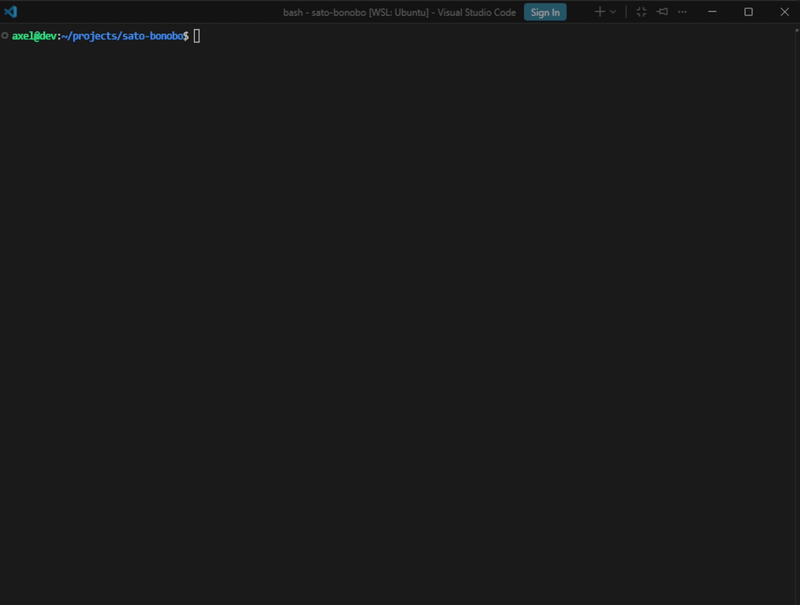

# Sato Bonobo

## :open_book: Overview

Implementation of a blockchain simulator in C modeling monetary creation, transaction processing, proof-of-work mining, and blockchain validation mechanisms.

## :hammer_and_wrench: Skills Demonstrated

- C Programming
- Blockchain Fundamentals
- Data Structures
- Cryptographic Hashing
- Merkle Tree Construction
- Algorithm Development
- Systems Programming
- Troubleshooting

## :rocket: Demo

## ⚙️ Technologies

- C
- Linux
- GCC
- SHA-256
- Merkle Trees
- Blockchain
- Proof-of-Work

## :closed_lock_with_key: Features

- Blockchain Generation
- Block Mining
- Proof-of-Work Consensus
- SHA-256 Hashing
- Merkle Root Computation
- Transaction Processing
- Monetary Creation Simulation
- Blockchain Validation
- Tampering Detection
- Configurable Mining Difficulty

## :busts_in_silhouette: Contributors

This project was developed by:

- [Axel Delas](https://github.com/axeldelas)
- [Amine Naim](https://github.com/aminenaim)
- Mamadou Djibo

as part of a three-person team.

## :raised_hands: Credits

Thank you for checking out our project!